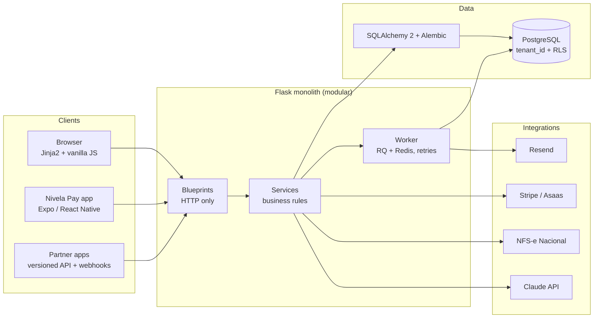
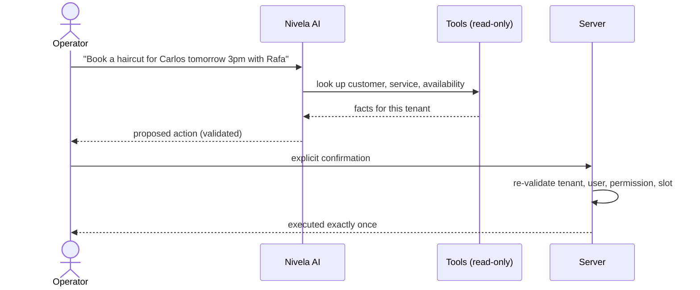

<h1 align="center">João Vargas</h1>

  Full-stack engineer building <strong>Nivela</strong>, a multi-tenant SaaS/ERP for service businesses in Brazil. 
  Financial correctness, tenant isolation and AI that asks before it acts.

  
  
  

  
  
  
  
  
  
  
  

---

## Nivela at a glance

Nivela is for appointment-driven businesses: barbershops, salons, clinics, pet care, fitness studios. One platform for scheduling, customers, cash flow, fiscal documents, subscriptions and an in-app AI assistant.

| | |
|---|---|
| **290+** | services holding the business rules |
| **560+** | HTTP routes across 70+ blueprints |
| **200+** | Alembic migrations |
| **390+** | test files |

Counted in the codebase in November 2026 and rounded down.

> **Explore it interactively →** the [portfolio](https://jrasch7.github.io/portfolio/) has a clickable architecture diagram, a tenant-isolation simulator and a walkthrough of the AI confirmation flow.

## How it is built

<b>Why a modular monolith</b>

One deploy, one codebase, clear layers. Blueprints only authenticate, read parameters, call a service and respond. Every new rule (money, stock, fiscal, commission, payment, integration) is born in a service, so the same rule serves the web app, the mobile app and the AI. Microservices only when there is real pain that justifies them.

<b>Multi-tenancy with a second barrier</b>

Every business query filters by `tenant_id`. PostgreSQL Row Level Security backs that up, so a forgotten `WHERE` in application code does not turn into a cross-customer leak. New tables are born with RLS in the same migration, and migrations that touch the schema are validated on a throwaway PostgreSQL (upgrade, downgrade, upgrade).

<b>Money and fiscal</b>

A title-based finance engine separates realized cash, contractual projection and overdue amounts. Bank reconciliation (OFX/CSV) is auditable and never changes cash on its own. A full review of the finance module found and fixed real bugs (interest applied per installment instead of on the total, refunds that were not symmetric, installment sums that diverged from the title), each now covered by regression tests. Fiscal documents are issued directly through the national NFS-e system and SEFAZ, with no paid middleman (recorded as an ADR).

<b>Background work that survives failure</b>

Emails, landing-page leads and heavy routines leave the request and run in an RQ worker. Each task gets its own app context, database session and tenant, and retries up to three times with growing waits (30 s, 2 min, 10 min).

## Nivela AI: useful without being unchecked

Three possible outcomes: a validated proposal, a clarifying question, or a clear refusal. The AI never writes business data directly. Every action needs explicit confirmation, is validated again on the server, is scoped to the right tenant and user, and runs only once (a repeated confirmation is ignored). Changes to prompts, tools or models are evaluated against a test set before they reach staging.

## Other work

| Project | What it is | Stack |
|---|---|---|
| **Nivela Pay** | iPhone and Android app with the business's payment account: balance, statement, transfers, receipts. No money rules in the app; amounts travel as integer cents. | Expo SDK 57, React Native, TypeScript strict |
| **[SulCore](https://github.com/sulcore/sulcore.github.io)** | Open, fully static company site built to show how we work: CI, CodeQL, OpenSSF Scorecard, Lighthouse CI, accessibility tests, numbered ADRs. | Next.js 16, TypeScript strict, Tailwind 4, Playwright |

## AI-assisted development, with guardrails

I use AI coding agents to investigate, plan, implement and review, and I do not delegate engineering judgment to them.

1. **Versioned context first.** Agents start from the repository's permanent rules (`AGENTS.md`), architecture and module docs, and a vault of product decisions and ADRs.
2. **Isolated work.** Every task starts from `staging` in its own branch or worktree. Agents never merge to the release branch or deploy production.
3. **Rules that protect the product.** Tenant isolation, authorization, migrations, financial correctness and regression coverage are non-negotiable.
4. **Evidence over summaries.** I read the actual diff and check additions and removals. An agent saying "done" is never the acceptance criterion.
5. **Quality gates.** Focused tests, broader suites when warranted, visual validation on real screens (desktop and phone), documentation updated in the same PR.
6. **Human decision points.** Merge, release and production validation stay deliberate human decisions, followed by smoke tests and monitoring.

## Engineering principles

- Start from the real operational workflow, then write code.
- Treat money, authorization and tenant isolation as first-class concerns.
- Ship in small, testable, additive increments with migration discipline.
- Keep documentation alive: outdated docs count as an unfinished delivery.

## Contact

[LinkedIn](https://www.linkedin.com/in/jo%C3%A3o-vargas/) · [joaovargas1108@gmail.com](mailto:joaovargas1108@gmail.com) · [Portfolio](https://jrasch7.github.io/portfolio/) · Novo Hamburgo, RS, Brazil
